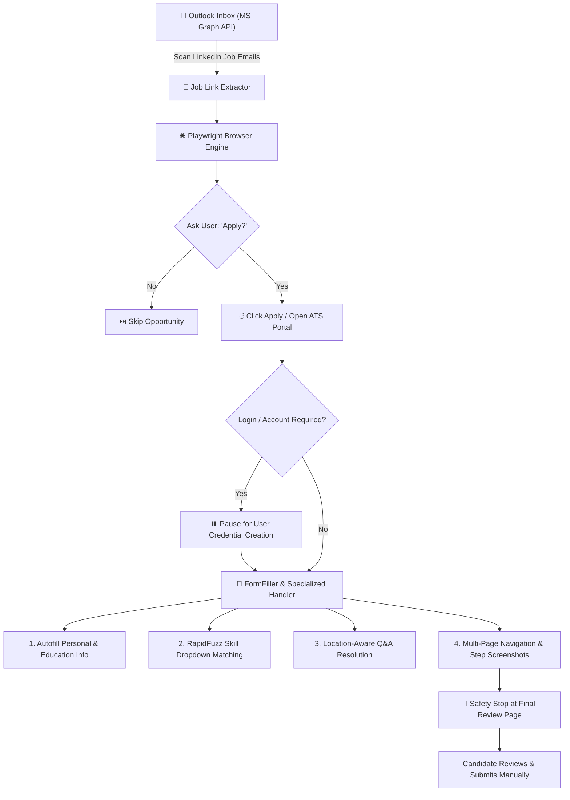

# Automatic Agentic JobApplicator & ATS Autofill

An intelligent, semi-autonomous assistant designed to eliminate the repetitive exhaustion of modern job applications.

---

## 💡 Why This Tool Matters in Modern Job Hunting

In today's hiring landscape, candidates are forced to repeat the exact same tedious routine dozens of times every week:
- Uploading a resume, only to be forced to manually re-type **First Name, Last Name, Phone, Email, Address, Zip Code, and College details** into broken ATS parsing forms.
- Navigating confusing multi-page corporate career sites (**Workday, Oracle Cloud / Taleo, Greenhouse, Lever, iCIMS, SmartRecruiters**).
- Answering repetitive compliance, visa sponsorship, legal authorization, and demographic questionnaires again and again.
- Wrestling with clunky skill dropdowns where your skill name (`React.js`) slightly differs from the site's option (`React`).

The **Automatic Agentic JobApplicator** solves this by acting as your personal co-pilot: it reads opportunities, detects input fields, maps candidate data with **fuzzy intelligence**, and steps through multi-page application forms—**always keeping you in control** with strict human-in-the-loop safeguards before any final submission.

---

## 🛠️ Architecture & How It Works



---

## 📥 Required Inputs & Configuration

The tool relies on three clean, human-editable YAML configuration files under `config/`:

1. **`config/settings.yaml`**:
   - Outlook / Microsoft Graph API client credentials (`client_id`, `tenant_id`, `lookback_days`).
   - Browser behavior (`headless: false`, `slow_mo: 500ms`, optional persistent Chrome profile directory).
   - Email keyword and sender filter rules.
   - Screenshot output directory.

2. **`config/resume_data.yaml`**:
   - Structured candidate profile: contact info, address, education history, work experience, certifications, and languages.
   - Candidate skill inventory used by the fuzzy matching engine.

3. **`config/qa_rules.yaml`**:
   - Rules engine mapping common ATS questionnaire prompts to standard answers:
     - Legal authorization to work (dynamically adjusted based on location).
     - Visa sponsorship requirements (e.g., Indian citizen applying locally vs internationally).
     - Standard EEO, veteran, disability, notice period, and relocation screening questions.

---

## 🚀 How the CLI Version Works

The command-line interface provides two flexible execution modes:

### Mode 1: Automated Outlook Email Pipeline
Fetches job opportunity notifications straight from your Outlook inbox via the Microsoft Graph API (using secure MSAL Device Code authentication):
```bash
python run.py
```
- Authenticates with your Microsoft account using a one-time code.
- Extracts unique LinkedIn job links from recent alert emails.
- Iterates through each job, displaying title, company, and location.
- Asks you: *"Apply to this job?"*
- Navigates through the ATS portal section-by-section, auto-populating fields and asking for your confirmation before each page progression.

### Mode 2: Direct URL Input Mode
If you already have specific LinkedIn or direct company career links, or if you prefer not configuring Microsoft Graph API:
```bash
python run.py --urls
```
- Paste any number of job URLs directly into the terminal prompt.
- The agent processes each link sequentially through the same automated ATS form-filling engine.

### Additional CLI Utilities:
- **Parse an existing resume into YAML:**
  ```bash
  python run.py --parse-resume /path/to/my_resume.pdf
  ```
  Extracts text and sections from PDF/DOCX to easily build your `resume_data.yaml`.
- **Run Headless:**
  ```bash
  python run.py --headless
  ```

---

## 🎯 Skill Section Matching & Location Awareness

### Fuzzy Skill Dropdown Matcher
ATS dropdowns often represent skills with slight variations (e.g., `NodeJS` vs `Node.js`, `K8s` vs `Kubernetes`, `Postgres` vs `PostgreSQL`).
The built-in `SkillMatcher` combines an extensive synonym dictionary (`AbbreviationMap`) with `RapidFuzz` composite scoring (`token_sort_ratio` + `partial_ratio`), ensuring your skills match the platform's dropdown choices accurately.

### Location-Aware Work Authorization
Standard questions like *"Do you need a visa to work at the location?"* or *"Are you legally authorized to work in this country?"* cannot be hardcoded with a single static value.
The `LocationAwareAnswerer` evaluates both the candidate's home citizenship (e.g., India) and the target job's geographical location:
- **India-based roles:** Authorized = `Yes`, Visa sponsorship required = `No`.
- **International roles (US/UK/EU):** Authorized without visa = `No`, Sponsorship required = `Yes`.

---

## 🔮 Roadmap & Future LLM Integration

Future updates will introduce direct Large Language Model (LLM) hooks (Gemini / Claude / OpenAI):
- **Dynamic Field Reasoning:** When an ATS site presents an unusual or open-ended question that does not match predefined rules, the agent will query an LLM using your resume context to draft a tailored, context-specific response.
- **Custom Cover Letter Tailoring:** Generate targeted 2-paragraph cover letters matching specific keywords from each job's scraped description.
- **Self-Healing Selectors:** LLM-assisted visual fallback to identify and interact with non-standard custom JavaScript web controls.

---

## 🖥️ GUI Desktop Version (In Progress)

> **Notice:** The standalone Graphical User Interface (GUI) desktop application is currently **in progress** and will be published in the `GUI/` directory in the next update.
>
> It will feature an integrated visual dashboard, real-time live browser preview, and a visual QA editor for non-technical users.
