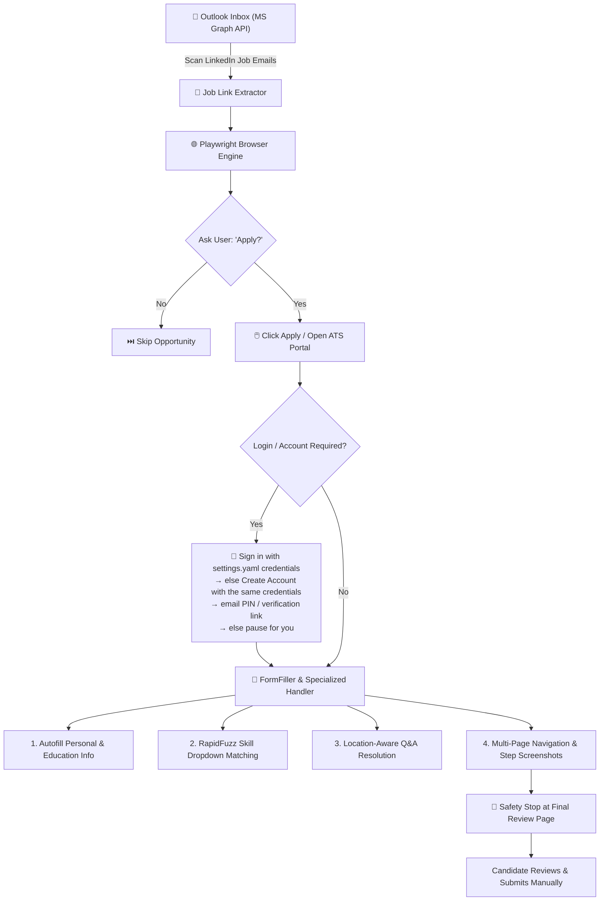

# Automatic Agentic JobApplicator & ATS Autofill

An intelligent, semi-autonomous assistant designed to eliminate the repetitive exhaustion of modern job applications.

---

## 💡 Why This Tool Matters in Modern Job Hunting

In today's hiring landscape, candidates are forced to repeat the exact same tedious routine dozens of times every week:
- Uploading a resume, only to be forced to manually re-type **First Name, Last Name, Phone, Email, Address, Zip Code, and College details** into broken ATS parsing forms.
- Navigating confusing multi-page corporate career sites (**Workday, Oracle Cloud / Taleo, Greenhouse, Lever, iCIMS, SmartRecruiters**).
- Answering repetitive compliance, visa sponsorship, legal authorization, and demographic questionnaires again and again.
- Wrestling with clunky skill dropdowns where your skill name (`React.js`) slightly differs from the site's option (`React`).

The **Automatic Agentic JobApplicator** solves this by acting as your personal co-pilot: it reads opportunities, detects input fields, maps candidate data with **fuzzy intelligence**, and steps through multi-page application forms—**always keeping you in control** with strict human-in-the-loop safeguards before any final submission.

---

## 🛠️ Architecture & How It Works



---

## ⚙️ Setup

```bash
cd "Python Source"
pip install -r requirements.txt
playwright install chromium
python run.py --help
```

Python 3.10+ is required. Run commands from the `Python Source` folder (paths in the configs are relative to it).

---

## 🏢 Supported Application Portals

| Portal | What is automated |
|---|---|
| **SAP SuccessFactors** (incl. jobs2web sites such as ANZ Careers, and company career sites in front of it such as Moody's) | "Apply now" menus and the portal's own job page, sign-in → create-account fallback (incl. data privacy statement dialog and the emailed one-time passcode), sign-in dialogs, register-and-apply pages (e.g. HSBC: account fields filled, *Apply* left for you), expand all sections, CV upload, one row per job/degree (rows kept together by their own Remove control), SAP picklists, UI5 date pickers. "I'm not a robot" checks are always left for you. |
| **Workday** | "Apply Manually", sign-in / create account, My Information, **Add** one card per job and degree, school & field-of-study search with nearest-proxy fallback, MM/YYYY dates, dropdowns, resume upload, questions, disclosures |
| **Oracle Recruiting Cloud** | email step + one-time PIN for returning candidates, searchable/dependent address fields (pin code → city/state), pill buttons (Title, Yes/No), resume upload, e-signature |
| **Oracle Taleo** | privacy agreement, login / New User registration, multi-page *Save and Continue* flow |
| Others (Greenhouse, Lever, iCIMS, SmartRecruiters, …) | generic form filling with the same matching engine |

The tool **never presses a final Submit button**: it stops at the review stage and hands over to you.

---

## 📥 Required Inputs & Configuration

The tool relies on three clean, human-editable YAML configuration files under `config/`:

1. **`config/settings.yaml`**:
   - Outlook / Microsoft Graph API client credentials (`client_id`, `tenant_id`, `lookback_days`).
   - Browser behavior (`headless: false`, `slow_mo: 500ms`, optional persistent Chrome profile directory).
   - Email keyword and sender filter rules.
   - Screenshot output directory.

2. **`config/resume_data.yaml`**:
   - Structured candidate profile: contact info, address, education history, work experience, certifications, and languages.
   - Per degree: `degree_aliases`, `university_aliases`, `field_of_study_aliases` and `field_of_study_fallbacks`
     (nearest proxies, e.g. *Production Engineering → Industrial Engineering*, *Analytics → Computer Science*).
   - `additional.resume_file`: the CV uploaded to resume fields.
   - Candidate skill inventory used by the fuzzy matching engine.

3. **`config/qa_rules.yaml`**:
   - Rules engine mapping common ATS questionnaire prompts to standard answers (whole-word matching;
     `answer_from: "section.field"` answers from `resume_data.yaml`). **Review the employer-declaration
     defaults (previous employment, auditor/family conflicts) for your own situation.**
     - Legal authorization to work (dynamically adjusted based on location).
     - Visa sponsorship requirements (e.g., Indian citizen applying locally vs internationally).
     - Standard EEO, veteran, disability, notice period, and relocation screening questions.

---

## 🚀 How the CLI Version Works

The command-line interface provides two flexible execution modes:

### Mode 1: Outlook job-alert pipeline (default)
```bash
python run.py                 # read mail, screen jobs, then apply / defer / cancel
python run.py --skip-email    # only work through pending and deferred jobs
python run.py --status        # show the job tracker
```
1. **Asks where the job alerts are:**
   - **Outlook on this PC** (default) - asks your permission, then which folder under Inbox (**LinkedIn** by
     default). No Azure/app registration: it drives the Outlook desktop app through Windows automation (COM).
     The *new Outlook for Windows* app has no automation interface, so classic Outlook is used - it reads the same
     mailbox once your account is set up in it (open classic Outlook once and sign in).
   - **A folder of saved emails** - emails saved as **DOCX, PDF, HTML, EML or MSG**; links hidden behind text
     (Word hyperlinks, PDF link annotations) are read too.
2. Reads **every** mail in that folder and opens each LinkedIn job link in turn:
   - **Experience** - the years the JD asks for must be **more than** `screening.min_years_experience` (12):
     *15+ years* and *12+ years* pass, *10+* or *8-12 years* are dropped.
   - **Still open?** - postings that no longer accept applications are dropped.
   - **Your call** - "Check your LinkedIn fit?" → shows the match LinkedIn displays (skills matched, match level)
     → "Add this job to your apply list?"
3. When all links in a mail are screened, the mail is **moved to Deleted Items** - or, for saved files, sent to
   the **Recycle Bin** (both recoverable). Stop with `q` and the remaining mails/files stay where they are.
4. Everything goes into **`data/job_tracker.json`**: job, company, location, experience asked, fit, mail date,
   scrape date, status (`pending`, `deferred`, `cancelled`, `applied`, `dropped`, `not_interested`), the date of
   the last status change and the full history. Links already in the tracker are never asked about twice.
5. Then every **pending and deferred** job is offered: **apply / defer / cancel**. Deferred jobs come back on each run.
   *Apply* runs the full automation (sign in with `settings.yaml` credentials → else create the account with the
   same ones → fill every section → stop at review). After you submit, answer *yes* and it is marked `applied`.

LinkedIn shows the fit (and Easy Apply) only when you are signed in: the pipeline uses a persistent browser
profile (`%LOCALAPPDATA%\JobApplicator\automation-profile`) - sign in to LinkedIn there once - or, if the
`--launch-chrome` window is open, it works in new tabs there.

Defaults live in `settings.yaml` → `mail:` (source, Outlook folder, saved-emails folder, move to trash).
Outlook on the web via Microsoft Graph remains available as an optional extra (`mail.graph_client_id`) for
machines without desktop Outlook - it is not needed otherwise.

### Mode 2: Direct URL Input Mode
If you already have specific LinkedIn or direct company career links, or if you prefer not configuring Microsoft Graph API:
```bash
python run.py --urls
```
- Paste any number of job URLs directly into the terminal prompt.
- The agent processes each link sequentially through the same automated ATS form-filling engine.

### Mode 3: Attach to the application you already have open
Work in your own browser window and let the tool fill whatever page you are on:
```bash
python run.py --launch-chrome                 # once per session: opens Chrome the tool can connect to
#   ...log in, start an application, get stuck on a long page...
python run.py --attach --url "<job or application link>"   # or a keyword: --url hsbc
```
- Chrome only allows this when started with remote debugging, and (since Chrome 136) not on your everyday
  profile - so `--launch-chrome` uses a dedicated profile (`%LOCALAPPDATA%\JobApplicator\chrome-profile`)
  where your portal logins are remembered between sessions.
- The tool scores every open tab against the link (host, job/requisition id, company parameter), so it still
  finds the tab after the portal has redirected; with several candidates it asks which one.
- It detects the portal and the current page/section, fills it from `resume_data.yaml`, and stops.
  Add `--all-sections` to carry on through the following pages (still never submitting).
- Your browser and tabs are left open - the tool only disconnects.

### Mode 4: Unattended run (testing)
```bash
python run.py --url <job-url> --auto --resume-data tests/regression/resume_data.yaml --settings <file>
```
Confirms prompts automatically and skips pauses; it still never submits.

### Additional CLI Utilities:
- **Parse an existing resume into YAML:**
  ```bash
  python run.py --parse-resume /path/to/my_resume.pdf
  ```
  Extracts text and sections from PDF/DOCX to easily build your `resume_data.yaml`.
- **Run Headless:**
  ```bash
  python run.py --headless
  ```

---

## 🎯 Skill Section Matching & Location Awareness

### Fuzzy Skill Dropdown Matcher
ATS dropdowns often represent skills with slight variations (e.g., `NodeJS` vs `Node.js`, `K8s` vs `Kubernetes`, `Postgres` vs `PostgreSQL`).
The built-in `SkillMatcher` combines an extensive synonym dictionary (`AbbreviationMap`) with `RapidFuzz` composite scoring (`token_sort_ratio` + `partial_ratio`), ensuring your skills match the platform's dropdown choices accurately.

### Location-Aware Work Authorization
Standard questions like *"Do you need a visa to work at the location?"* or *"Are you legally authorized to work in this country?"* cannot be hardcoded with a single static value.
The `LocationAwareAnswerer` evaluates both the candidate's home citizenship (e.g., India) and the target job's geographical location:
- **India-based roles:** Authorized = `Yes`, Visa sponsorship required = `No`.
- **International roles (US/UK/EU):** Authorized without visa = `No`, Sponsorship required = `Yes`.

---

## 🧪 Testing

```bash
python -m unittest discover -s tests -v      # offline: label mapping, option matching, QA/location rules
python tests/regression_live.py              # live portals with the GARBAGE profile in tests/regression/
python tests/regression_live.py workday_citi --headed
```

The live regression uses `tests/regression/resume_data.yaml` (dummy persona) and creates **throwaway
portal accounts with a disposable mail.tm inbox** (saved in `tests/regression/state*.json`, so a re-run
exercises the "already have an account → sign in" path). Targets live in `tests/regression/sites.yaml`.
Each run writes a JSON report and full-page screenshots to `tests/regression/out/<site>/`.

---

## 🔮 Roadmap & Future LLM Integration

Future updates will introduce direct Large Language Model (LLM) hooks (Gemini / Claude / OpenAI):
- **Dynamic Field Reasoning:** When an ATS site presents an unusual or open-ended question that does not match predefined rules, the agent will query an LLM using your resume context to draft a tailored, context-specific response.
- **Custom Cover Letter Tailoring:** Generate targeted 2-paragraph cover letters matching specific keywords from each job's scraped description.
- **Self-Healing Selectors:** LLM-assisted visual fallback to identify and interact with non-standard custom JavaScript web controls.

---

## 🖥️ GUI Desktop Version (In Progress)

> **Notice:** The standalone Graphical User Interface (GUI) desktop application is currently **in progress** and will be published in the `GUI/` directory in the next update.
>
> It will feature an integrated visual dashboard, real-time live browser preview, and a visual QA editor for non-technical users.

